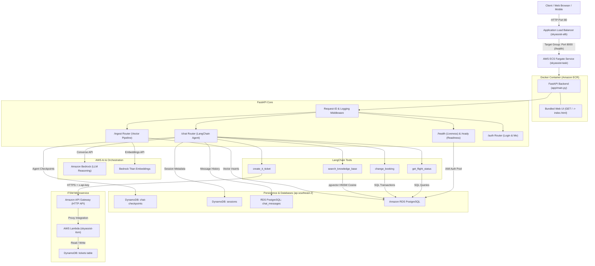

# SkyAssist: Agentic AI on AWS

## Project Overview

**SkyAssist** is a production-grade Agentic AI service built for airline operations, customer support, and IT incident management. Powered by **Python, FastAPI, LangChain, and Amazon Bedrock**, SkyAssist acts as an intelligent enterprise copilot capable of autonomously reasoning about user requests, invoking specialized operational tools, and maintaining multi-turn context across conversations.

---

## Architecture Diagram



---

## AWS Services Used and Why

| AWS Service | Component in SkyAssist | Purpose & Role |
| :--- | :--- | :--- |
| **Amazon Bedrock (Runtime)** | `ChatBedrockConverse` | High-accuracy LLM reasoning, multi-turn dialogue, and autonomous tool calling. |
| **Amazon Bedrock (Embeddings)** | `BedrockEmbeddings` (Titan Text v2) | Converts ingested documents and search queries into 512/1024-dimensional normalized vectors. |
| **Amazon RDS PostgreSQL** | Relational DB + `pgvector` extension | Stores operational flight schedules, passenger bookings, and document vector embeddings. Secured via **passwordless IAM database authentication** (`generate_db_auth_token`) refreshed automatically by `psycopg-pool`. |
| **Amazon DynamoDB** | `chat-checkpoints`, `sessions`, `tickets` | Fully serverless NoSQL storage (on-demand billing):<br>• `chat-checkpoints`: State and message memory for LangGraph agent (30-day TTL auto-cleanup).<br>• `tickets`: Operational incident tickets created by the ITSM Lambda. |
| **AWS Lambda** | `skyassist-itsm` (`itsm_lambda/handler.py`) | Serverless microservice handling IT ticketing operations (`POST /tickets`, `GET /tickets/{id}`). |
| **Amazon API Gateway** | HTTP API v2 (`4afwd28wp5`) | Public HTTPS front door routing traffic to the ITSM Lambda, enforcing `x-api-key` authentication and CORS. |
| **Amazon S3** | `s3` boto3 client | Storage for enterprise policy documents and raw data ingestion. |
| **Amazon ECR** | Container Image Registry | Secure private registry hosting multi-stage container images (`skyassist:latest`). |
| **AWS ECS (Fargate)** | Container Orchestration (Serverless) | Runs the containerized FastAPI service and bundled web UI with 0.5 vCPU and 1 GB RAM, eliminating EC2 server patching. |
| **AWS Application Load Balancer** | `skyassist-alb` | Public internet entry point routing HTTP traffic on Port 80 to container Port 8000 with continuous `/health` checks. |
| **Amazon CloudWatch** | CloudWatch Logs (`/ecs/skyassist-task`) | Centralized log group streaming single-line JSON logs with correlated `request_id`, HTTP status, and latency metrics. |
| **AWS Secrets Manager & SQS** | Client factories in `app/core/aws.py` | Prepared for credential isolation and asynchronous ingestion queues. |

---

## What the Current Application Can Do

1. **Stateful Multi-Turn Agentic Chat (`POST /chat`)**:
   - The user converses with the assistant providing a `session_id`.
   - The LangChain agent running on Amazon Bedrock parses intent, maintains conversation history in DynamoDB, and autonomously executes backend tools.
   - Responds politely to conversational follow-ups remembering previous actions in the session.
2. **Flight Operations Inquiries (`get_flight_status`)**:
   - Checks real-time flight status (e.g. `ON TIME`, `DELAYED`, `CANCELLED`), delay minutes, gate assignments, and departure/arrival times.
   - Accepts flexible dates (`"today"`, `"tomorrow"`, or `YYYY-MM-DD`).
   - Recommends alternate scheduled dates if a flight is not operating on the requested day.
3. **Booking Modifications (`change_booking`)**:
   - Validates passenger PNR confirmation codes (e.g. `CONF1A`).
   - Runs database row locking (`FOR UPDATE`) to ensure transactional consistency.
   - Prevents booking onto cancelled flights or re-booking identical flights.
   - Updates passenger reservation and returns updated flight and gate details.
4. **IT Incident Management (`create_it_ticket`)**:
   - Allows operations and gate staff to report hardware, kiosk, scanner, or baggage belt malfunctions.
   - Validates priority (`P1`–`P4`), issue summary, and reporter email.
   - Invokes the live AWS API Gateway $\rightarrow$ Lambda $\rightarrow$ DynamoDB `tickets` table with secret API key authentication.
5. **Knowledge Base Retrieval-Augmented Generation (`search_knowledge_base`)**:
   - Semantically searches ingested airline policy documents using `pgvector` HNSW cosine similarity.
6. **Document Ingestion (`POST /ingest`)**:
   - Splits text into overlapping chunks, generates Bedrock Titan embeddings, and writes vectors to RDS PostgreSQL.
7. **Production Observability & Probes**:
   - Request-ID middleware assigning or propagating `X-Request-ID` across async contextvars.
   - Standardized single-line JSON logging formatted for CloudWatch Logs Insights.
   - **`GET /health`**: Liveness probe for ALB and container orchestrator.
   - **`GET /ready`**: Readiness probe checking PostgreSQL database connectivity with timeout safeguards.

---

## Database Schemas

### 1. Amazon RDS PostgreSQL (Relational & Vectors)

#### `flights` Table
Stores scheduled airline flights, operating routes, and real-time status.
```sql
CREATE TABLE IF NOT EXISTS flights (
    flight_number  VARCHAR(10) NOT NULL,
    flight_date    DATE NOT NULL,
    origin         VARCHAR(4) NOT NULL,
    destination    VARCHAR(4) NOT NULL,
    departure_time TIME NOT NULL,
    arrival_time   TIME NOT NULL,
    status         VARCHAR(20) NOT NULL DEFAULT 'ON TIME',
    gate           VARCHAR(10),
    delay_minutes  INT NOT NULL DEFAULT 0,
    PRIMARY KEY (flight_number, flight_date)
);
```

#### `bookings` Table
Stores customer reservations and seat assignments linked to scheduled flights.
```sql
CREATE TABLE IF NOT EXISTS bookings (
    booking_ref    VARCHAR(10) PRIMARY KEY,
    passenger_name VARCHAR(100) NOT NULL,
    flight_number  VARCHAR(10) NOT NULL,
    flight_date    DATE NOT NULL,
    seat           VARCHAR(10) NOT NULL DEFAULT 'OPEN',
    status         VARCHAR(20) NOT NULL DEFAULT 'CONFIRMED',
    updated_at     TIMESTAMP WITH TIME ZONE DEFAULT CURRENT_TIMESTAMP,
    FOREIGN KEY (flight_number, flight_date)
        REFERENCES flights (flight_number, flight_date)
        ON UPDATE CASCADE
);
```

#### `documents` Table (`pgvector`)
Stores document chunks and high-dimensional vector embeddings for semantic RAG.
```sql
CREATE EXTENSION IF NOT EXISTS vector;

CREATE TABLE IF NOT EXISTS documents (
    id        UUID PRIMARY KEY,
    source    TEXT NOT NULL,
    content   TEXT NOT NULL,
    embedding vector(512) NOT NULL
);

CREATE INDEX IF NOT EXISTS documents_embedding_idx
    ON documents USING hnsw (embedding vector_cosine_ops);
```

#### `chat_messages` Table (Persistent Chat History for UI)
Stores clean, permanent, human-readable user and assistant conversation history. Guarantees that chat history is never lost to TTL or binary serialization issues.
```sql
CREATE TABLE IF NOT EXISTS chat_messages (
    id         UUID PRIMARY KEY DEFAULT gen_random_uuid(),
    session_id VARCHAR(64) NOT NULL,
    user_id    VARCHAR(64) NOT NULL DEFAULT 'vamsi',
    role       VARCHAR(20) NOT NULL,
    content    TEXT NOT NULL,
    tool_calls JSONB,
    created_at TIMESTAMP WITH TIME ZONE DEFAULT CURRENT_TIMESTAMP
);

CREATE INDEX IF NOT EXISTS idx_chat_messages_session
    ON chat_messages (session_id, created_at ASC);
```

---

### 2. Amazon DynamoDB (NoSQL Tables - On-Demand)

#### A. `chat-checkpoints` Table
Used by `DynamoDBSaver` (`langgraph-checkpoint-aws`) for LangGraph state management.
- **Partition Key (`PK`):** String (`S`) — e.g. `test-session-1` or `CHUNK_<session_id>#...`
- **Sort Key (`SK`):** String (`S`) — e.g. `checkpoint#...`
- **Billing Mode:** `PAY_PER_REQUEST` (On-Demand)
- **TTL Attribute:** Automatic expiration after 30 days.

#### B. `tickets` Table
Populated by the ITSM Lambda microservice via API Gateway.
- **Partition Key (`ticket_id`):** String (`S`) — e.g. `INC-322CAF`
- **Attributes:**
  - `issue_summary`: String (`S`) — Problem description
  - `priority`: String (`S`) — `P1`, `P2`, `P3`, or `P4`
  - `reporter_email`: String (`S`) — Contact email
  - `status`: String (`S`) — `OPEN`, `IN_PROGRESS`, `RESOLVED`
  - `created_at`: String (`S`) — ISO 8601 timestamp
- **Billing Mode:** `PAY_PER_REQUEST` (On-Demand)

#### C. `sessions` Table
Dedicated session index table for user metadata and active session lookups.
- **Partition Key (`session_id`):** String (`S`)
- **Billing Mode:** `PAY_PER_REQUEST` (On-Demand)

---

## Codebase Structure

```
indian/
├── app/
│   ├── main.py              # FastAPI application, lifespan, root UI route (GET /), /health & /ready
│   ├── core/
│   │   ├── aws.py           # Centralized Boto3 session & AWSClients factory with retry configs
│   │   ├── config.py        # Environment variables & runtime settings (Pydantic BaseSettings)
│   │   ├── db.py            # RDS PostgreSQL connection pool with dynamic IAM auth & idempotent init_db()
│   │   ├── dynamodb.py      # Idempotent provisioning for sessions, tickets, and checkpoints tables
│   │   └── logging.py       # Context-aware structured JSON logging (CloudWatch-compatible)
│   ├── routers/
│   │   ├── auth.py          # Static authentication router (POST /auth/login, GET /auth/me)
│   │   ├── chat.py          # Bedrock agent, DynamoDB session history, POST /chat & POST /chat/stream
│   │   ├── ingest.py        # Document chunking, Bedrock embedding, and pgvector storage pipeline
│   │   └── mock_itsm.py     # Local stub router for ITSM testing without internet/AWS access
│   ├── tools/
│   │   ├── __init__.py      # Package export for agent tools
│   │   ├── flights.py       # get_flight_status & change_booking tools (SQL + validation)
│   │   └── itsm.py          # create_it_ticket tool (HTTP POST with x-api-key to API Gateway)
│   └── utils/
│       ├── helpers.py       # String and content extraction helpers
│       └── schemas.py       # Pydantic models (ChatInput, Login, Session, MessageItem)
├── itsm_lambda/
│   └── handler.py           # AWS Lambda backend for API Gateway POST /tickets & GET /tickets/{id}
├── tests/
│   ├── test_chat.py         # Pytest suite for /chat, /chat/stream, /sessions, and /auth
│   ├── test_itsm_lambda.py  # Pytest suite for ITSM Lambda handler & auth
│   └── test_tools.py        # Pytest suite for flight and ITSM tools input validation & SQL
├── Dockerfile               # Multi-stage container recipe (builder + non-root runner)
├── .dockerignore            # Excludes venv, tests, git, and local secrets from Docker images
├── requirements.txt         # Pinned production dependencies with integrity hashes
├── index.html               # Responsive airline copilot Web UI (Lucide icons, SSE streaming)
├── BUILD_PLAN.md            # Comprehensive 3-day roadmap, scope tiers, and operational guide
├── pyproject.toml           # Project dependencies & pytest configuration
├── run.bat                  # Local development startup script
└── README.md                # Project documentation & architecture overview
```

---

## API Endpoints Reference

| Method | Endpoint | Description |
| :--- | :--- | :--- |
| `GET` | `/` | **Serves the interactive SkyAssist Web UI** directly from the container |
| `POST` | `/chat` | Standard synchronous agent chat returning complete response and session ID |
| `POST` | `/chat/stream` | **Real-time SSE streaming:** emits token deltas, tool calls, and token usage metrics |
| `GET` | `/sessions` | Lists previous chat conversation threads for a user from DynamoDB (for UI sidebar) |
| `GET` | `/chat/{session_id}` | Retrieves full chronological message history from PostgreSQL (with fallback to DynamoDB) |
| `DELETE` | `/chat/{session_id}` | Deletes session metadata from DynamoDB and message history from PostgreSQL |
| `POST` | `/auth/login` | Static login endpoint returning user profile and session bearer token (`guest1`/`guest2`) |
| `GET` | `/auth/me` | Retrieves active user identity from bearer token |
| `POST` | `/ingest` | Chunk and embed raw text into RDS PostgreSQL (`pgvector`) |
| `GET` | `/health` | Liveness probe for ALB and container orchestrator (HTTP 200) |
| `GET` | `/ready` | Readiness probe validating RDS PostgreSQL connectivity with timeout (HTTP 200 / 503) |
| `POST` | `/mock-itsm/tickets` | Local stubbed endpoint for IT ticket creation |
| `GET` | `/mock-itsm/tickets/{id}`| Local stubbed endpoint for IT ticket retrieval |

---

## Real-Time SSE Streaming Format (`POST /chat/stream`)

The streaming endpoint returns a `text/event-stream` delivering structured events tailored for rich frontend rendering:

```
data: {"type": "session", "session_id": "session-123"}

data: {"type": "tool_start", "tool": "get_flight_status", "input": {"flight_number": "WN1234", "date": "today"}}

data: {"type": "tool_end", "tool": "get_flight_status", "output": "Flight WN1234 on 2026-10-20: ON TIME. Route: DAL -> HOU. Departure: 08:00, Arrival: 09:10. Gate A12."}

data: {"type": "token", "content": "Flight "}
data: {"type": "token", "content": "WN1234 "}
data: {"type": "token", "content": "is currently on time..."}

data: {"type": "metadata", "usage": {"input_tokens": 748, "output_tokens": 85, "total_tokens": 833, "latency_ms": 620}}

data: {"type": "done", "session_id": "session-123"}
```

---

## Running and Testing Locally

### 1. Run the Development Server
```powershell
.\run.bat
```
FastAPI interactive Swagger docs: **`http://localhost:8000/docs`**

### 2. Execute Pytest Test Suite
```powershell
uv run pytest tests/
```
All **24 unit tests** execute cleanly verifying streaming, auth, session history, auto-rehydration from PostgreSQL, tools, database queries, and Lambda handlers.

---

## Cloud Deployment (AWS ECS Fargate & ALB)

SkyAssist is packaged as an optimized, multi-stage Docker container running serverlessly on **AWS ECS Fargate** behind an **Application Load Balancer (ALB)**.

### Live Cloud Endpoint
- **Public Application URL:** [`http://skyassist-alb-1144392515.ap-southeast-2.elb.amazonaws.com`](http://skyassist-alb-1144392515.ap-southeast-2.elb.amazonaws.com)
- **Liveness Health Check:** `http://skyassist-alb-1144392515.ap-southeast-2.elb.amazonaws.com/health`
- **Default Guest Credentials:**
  - **Username:** `guest1` or `guest2`
  - **Password:** `indian2026`

### Container Architecture & Build Flow

1. **Multi-Stage Build (`Dockerfile`)**:
   - **Stage 1 (`builder`)**: Uses `python:3.13-slim` and `build-essential` to compile wheels and prepare a clean virtual environment at `/opt/venv`.
   - **Stage 2 (`runner`)**: Uses a minimal runtime footprint, copies `/opt/venv`, creates a dedicated non-root user `appuser` (UID 1001), copies application code and `index.html`, and configures container `HEALTHCHECK`.

2. **Build and Push to Amazon ECR**:
   ```bash
   # 1. Authenticate Docker with Amazon ECR
   aws ecr get-login-password --region ap-southeast-2 | docker login --username AWS --password-stdin 089601768834.dkr.ecr.ap-southeast-2.amazonaws.com

   # 2. Build and tag the multi-stage image
   docker build -t skyassist:latest .
   docker tag skyassist:latest 089601768834.dkr.ecr.ap-southeast-2.amazonaws.com/skyassist:latest

   # 3. Push to ECR repository
   docker push 089601768834.dkr.ecr.ap-southeast-2.amazonaws.com/skyassist:latest
   ```

3. **ECS Fargate Task & Service**:
   - **Task Definition (`skyassist-task`)**: 0.5 vCPU, 1 GB RAM, Fargate launch type, container port `8000`.
   - **Service (`skyassist-task-service`)**: Ensures `1/1` tasks continuously running with rolling deployments.
   - **Application Load Balancer (`skyassist-alb`)**: Routes internet HTTP traffic on port 80 to container port 8000 across multiple availability zones, continuously executing `/health` checks.

